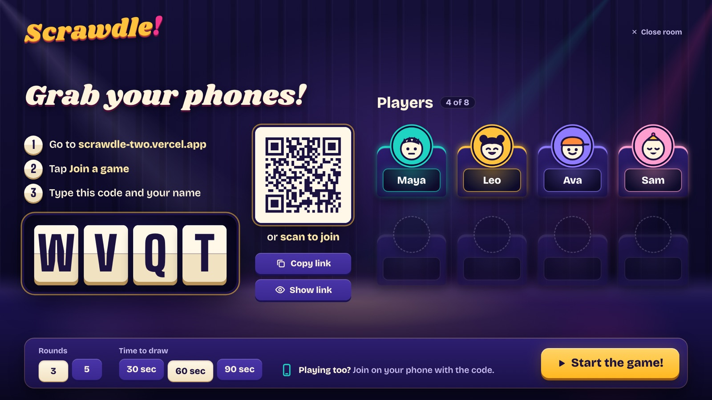

# Scrawdle

**Play it now: [scrawdle-two.vercel.app](https://scrawdle-two.vercel.app)**

A drawing party game for friends and families. Put Scrawdle on a TV or laptop, everyone joins on their own phone with a short room code, a die rolls to pick one word to draw, and then everyone votes for their favourite drawing without knowing who drew what.

Programmer: **Zainab Stanikzy** ([zainasuw](https://github.com/zainasuw))



## How it plays

1. **Host a game** on a TV or laptop. The screen shows a room code and a QR code.
2. Everyone joins on their own phone: scan the QR code, open a link the host shares (Copy link, Share or Text a link), or go to the site, tap **Join a game** and type the code. Then pick a name.
3. A die rolls onto the stage and lands on a category (Animal, Food, Silly, Place, Thing, Wild), then the word flips onto the board, like *a penguin on a skateboard*.
4. Everyone draws it on their phone before the clock runs out.
5. The TV shows every drawing with no names, and everyone votes on their phone (never for their own).
6. Names and points are revealed: 100 points per vote, plus 50 for the best drawing. The next round starts by itself after a short countdown. After 3 or 5 rounds, the winner takes the podium.

The host plays too by joining on their own phone; the TV only runs the show, so voting stays anonymous.

**Keeping it friendly:** once a game starts the room is locked. Someone who arrives late can ask to join, and the host decides (Let in or Not now) right on the TV. The host can also remove a player from the lobby. Party drawings are never saved anywhere; they go from the phones to the TV and disappear.

**Solo modes:** **Daily Word** (the same word for everyone each day) and **Quick draw** (a random word any time). Finished drawings can be replayed, downloaded as a PNG and shared. A public gallery and leaderboard are built in but switched off by default (see Deploy).

## Run it locally

You need Python 3 (or any static file server) and a modern browser. There is no build step.

```sh
cd frontend
python3 -m http.server 8000
```

Open <http://localhost:8000>. Daily Word, Quick draw and the drawing tools work straight away. Hosting a party needs online play (below).

## Run the tests

Needs Node 18 or newer. No packages to install.

```sh
node --test tests/*.test.js
```

## Online play (party rooms)

Online features use [Supabase](https://supabase.com) (free plan is enough):

1. Create a Supabase project.
2. In its SQL Editor, run `backend/supabase/schema.sql`, then create a public storage bucket named `drawings` (see the comments in that file).
3. Put the project URL and its **anon** (public) key in `frontend/supabase-config.js`. Never commit the service_role key.

Party rooms use Supabase Realtime (presence and broadcast). To clear old room codes every day, also run `backend/supabase/updates/007-clear-old-rooms.sql` once. The optional daily cleanup of old gallery drawings is described in `backend/README.md`.

## Deploy

It's a static site; Vercel is set up for it (`vercel.json`). Import the repo at vercel.com, add these environment variables, and deploy:

- `SUPABASE_URL`: your project's URL
- `SUPABASE_ANON_KEY`: its publishable (anon) key, never the secret key
- `PUBLIC_GALLERY`: `true` to turn on the public gallery and leaderboard (off by default)

During the build, `build/write-config.js` writes them into `frontend/supabase-config.js`, so they stay out of the repo. Every push to `main` redeploys.

## Project layout

- `frontend/`: the whole game (plain HTML, CSS and JavaScript, no framework).
  - `index.html`: home, the dice reveal, solo drawing and finish screens.
  - `party.js`, `party-rules.js`, `lobby.js`: the party game, its rules and the rooms.
  - `drawing.js`: drawing tools, undo and redo, auto-save, replay and the finish screen.
  - `dice.js`, `words.json`, `daily.js`: the die, the word list and the word of the day.
  - `stage.css` plus one stylesheet per screen: the TV game-show look (documented in `DESIGN.md`).
- `backend/supabase/`: the database schema and the daily cleanup function.
- `tests/`: unit tests for the game logic.
- `build/write-config.js`: fills in the Supabase settings when Vercel builds the site.

## About

What Scrawdle includes:

- A same-room party game: a TV host screen, joining by room code on phones, rounds, anonymous voting, points, a scoreboard and a winner podium.
- One word to draw, picked by an animated 3D dice roll from an original list of 252 kid-friendly words.
- Joining by QR code or invite link, rooms that lock once a game starts, late players asking the host to join, and the host removing a player.
- Daily Word and Quick draw for solo play.
- Every screen designed as a TV game show, with phones as contestant buzzer pads.
- Phones play on one screen with no scrolling, with 44px touch targets and readable contrast throughout.
- The design system is documented in `DESIGN.md`.

Fonts: Shrikhand, Big Shoulders Display and Bricolage Grotesque, all under the SIL Open Font License.
